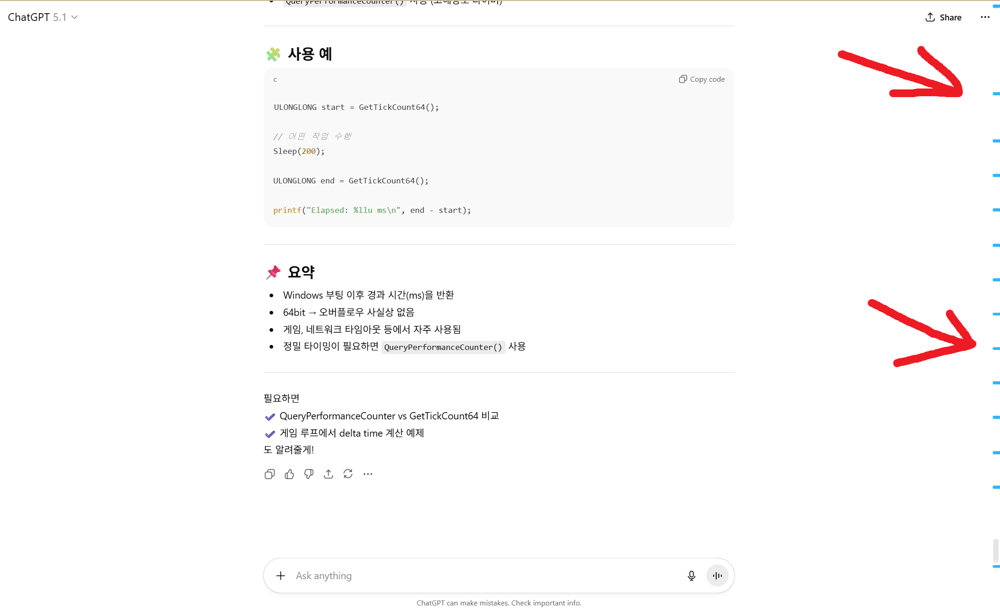
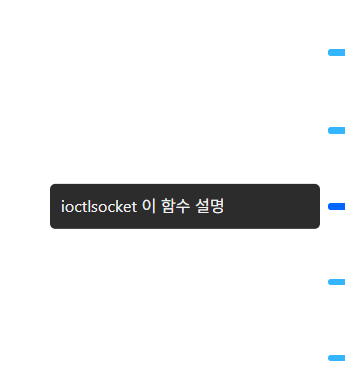
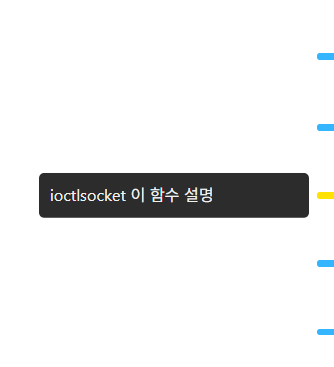
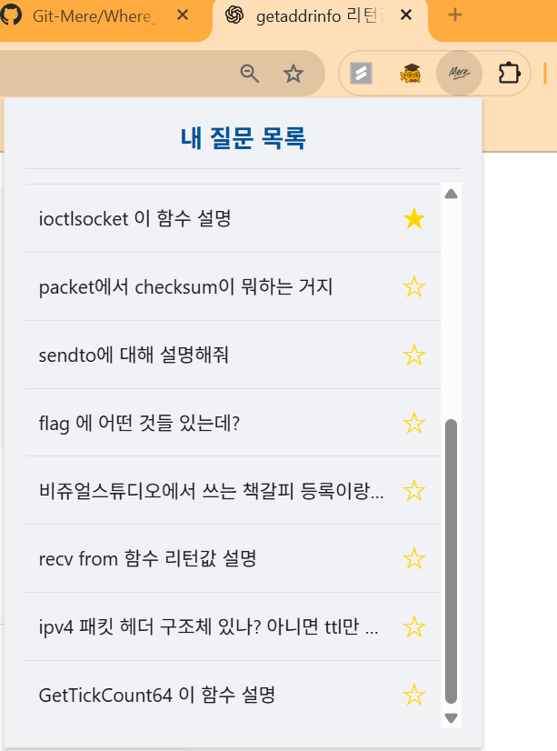

# Where Is the Question?

A Chrome extension that pins your questions as scrollbar markers so you never lose your place in a long AI chat.


## Features

- **Automatic scrollbar markers** — a blue marker for every question appears beside the scrollbar as soon as you open a conversation, even in long chats where the site only renders part of the page
- **Inline preview tooltip** — hover over a marker to read the question text without scrolling
- **One-click navigation** — click any marker to jump directly to that question, even if the site has not rendered it yet
- **Favorites** — right-click a marker to toggle it yellow and flag it as important
- **Popup question list** — open the extension popup to browse all questions and favorites, and navigate to any of them from one place

## Demo

**Basic view** — question markers generated along the scrollbar.



**Preview** — hovering a marker shows that question's text.



**Favorites** — a marker right-clicked into the yellow favorite state.



**Popup** — browsing and jumping to questions from the extension popup.



Live listing: [Chrome Web Store](https://chromewebstore.google.com/detail/where-is-the-question/gnidmiclaanakeggddihdkepihmpkpff)

## Built With

- **JavaScript** — all extension logic, including DOM observation, scroll-position math, and popup–content-script communication
- **Chrome Extension API (content scripts + popup)** — allows the extension to inject markers into the host page and expose a management UI without modifying the site itself
- **CSS** — positions the marker overlay on top of the native scrollbar track and styles tooltips without leaking into the host page's stylesheet
- **HTML** — minimal popup shell for rendering the question and favorites lists

Supported AI platforms: ChatGPT, Gemini, Claude.

## Getting Started

### Prerequisites

- Google Chrome (or any Chromium-based browser)

### Option A — Install from the Chrome Web Store

[Install directly](https://chromewebstore.google.com/detail/where-is-the-question/gnidmiclaanakeggddihdkepihmpkpff) and the extension is ready to use immediately.

### Option B — Load unpacked (for development)

```bash
git clone https://github.com/Git-Mere/Where_is_the_question.git
```

1. Open Chrome and go to `chrome://extensions`
2. Enable **Developer mode** (top-right toggle)
3. Click **Load unpacked** and select the cloned folder

### Usage

Open a conversation on ChatGPT, Gemini, or Claude. Markers for every question appear on the scrollbar automatically, and new ones are added as you send questions.

| Action | Result |
|--------|--------|
| Click a marker | Scrolls to that question |
| Hover over a marker | Shows question text in a tooltip |
| Right-click a marker | Toggles the yellow favorites state |
| Open the popup | Lists all questions and favorites with jump links |

> If markers do not appear after installing, refresh the page once.

## What I Learned

**Detecting questions on dynamically rendered pages**

AI chat interfaces like ChatGPT render new messages by updating the DOM asynchronously — there is no page navigation to hook into. The initial approach of reading the DOM once on page load captured nothing after the first render. The fix was attaching a `MutationObserver` to the conversation container and responding to each newly inserted user-message node. This meant every question, whether submitted a second after load or an hour later, triggered a new marker immediately.

**Platform-specific DOM targeting without duplicating logic**

Each supported platform uses its own HTML structure for user messages, and those structures change without notice. Rather than writing separate content scripts for each site, each platform is a small adapter in `src/modules/sites.js` that reports the scroll container, the questions currently on screen, and (when available) the full question list. The observation, layout, and rendering logic stays in one place, so a site redesign only touches its adapter.

**Mapping element positions to scrollbar coordinates**

The markers sit beside the native scrollbar, not inside the scrollable content. Calculating where to place a marker meant converting a message element's position within the container's full `scrollHeight` into a percentage of the scrollbar track height — and recalculating those positions whenever the window resizes or new content shifts existing messages downward. Getting this mapping accurate across different viewport sizes was the most iterative part of the project.

**Long conversations that the site does not fully render**

ChatGPT and Claude only keep a handful of messages in the DOM at a time, and ChatGPT loads older messages only when you scroll to the top. Reading the page alone therefore misses most questions. The extension reads the open conversation from the same site (with your existing login) to get the full question list, measures the questions that are on screen, and places the rest by interpolating between measured positions using each turn's text length. Clicking a marker for an off-screen question jumps to the estimated spot, waits for the site to render it, and then lands exactly on it.

## License

Distributed under the MIT License. See [LICENSE](./LICENSE) for details.
